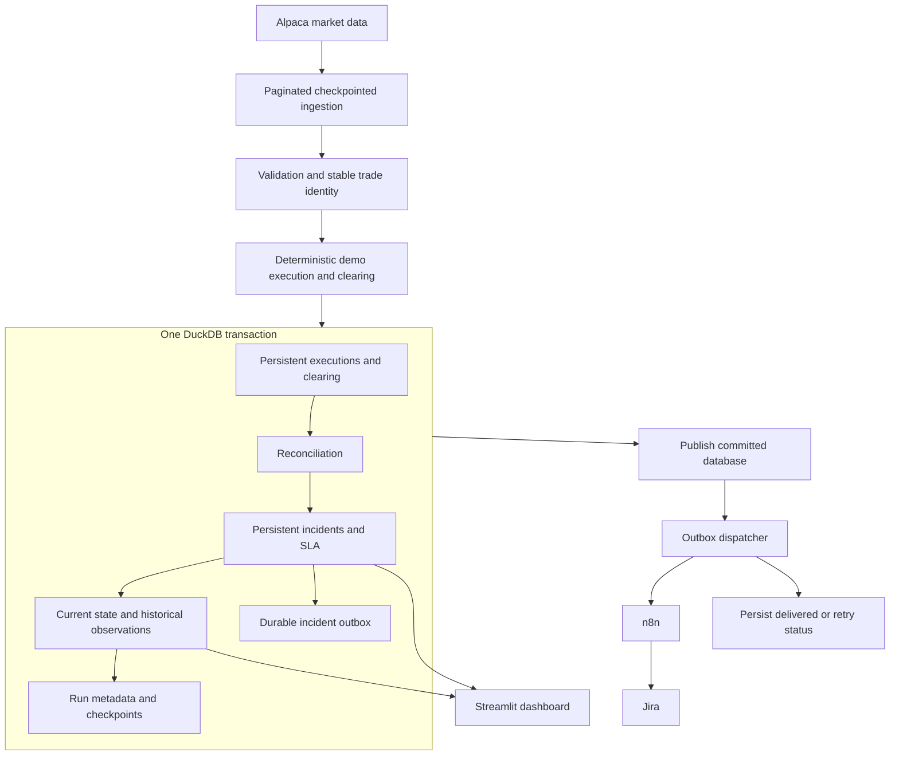

# TradeOps - Trading Operations Analytics & Exception Management

[](https://vivianle-2209-tradeops-platform-dashboardapp-qveqlz.streamlit.app/)

TradeOps is a single-worker Python portfolio project for execution-to-clearing
reconciliation, exception prioritisation, persistent incident tracking, SLA
monitoring, and n8n/Jira escalation. It uses DuckDB, Streamlit, GitHub Actions,
n8n and Jira. The existing white/black/pink dashboard remains the presentation layer.
Market trades come from Alpaca's IEX feed; internal execution attributes and
clearing records are deliberately simulated. No real orders are placed.

## Architecture



Ingestion windows are transport boundaries. **DuckDB is the operational source of
truth.** Source records, unresolved incidents and pending delivery survive beyond
the window that originally introduced them. CSVs under `data/processed` are legacy
standalone-script exports, not authoritative pipeline state. Old lifecycle and
dispatch CSVs are not read or recreated by the worker.

The worker remains a normal sequential Python program; there are no services,
queues, brokers or background jobs inside Streamlit. Domain functions are directly
callable and testable, and the major boundaries use explicit typed table contracts.

## Identity and contracts

| Identifier | Meaning |
| --- | --- |
| `trade_id` | Permanent SHA-256 identity of JSON-encoded feed/source, symbol, UTC execution date, exchange/venue and source trade ID. Independent of batch order and run. |
| `run_id` | One logical worker attempt, UUID by default. Supply the same `--run-id` to retry it. GitHub uses `gha-<github.run_id>`, stable across workflow reruns. |
| `snapshot_id` | Deterministic hash of the logical run ID; identifies one committed historical observation. |
| `snapshot_number` | Human-readable ordinal, allocated transactionally starting at **1**. Failed runs and an initially empty no-data run do not consume it. |
| `dedup_key` | Permanent `trade_id:exception_type` incident identity. |
| `break_id` | Deterministic hash of the incident key; stable across observations and reopening. |
| `incident_id` | Stable incident entity identity, separately named for event consumers. |
| `event_id` | Hash of incident ID and monotonically increasing event version. Unchanged during delivery retries. |

`src/contracts.py` defines explicit execution, clearing, reconciliation, break,
incident, outbox, run and historical-observation column types. Required identities,
economics, timestamps, finite values, and key uniqueness are validated at stage
boundaries. Invalid input rejects the batch before checkpoint advancement.

Both execution and clearing evidence retain their own symbol, side, account,
currency, quantity, price, venue/source and timestamps. Unknown evidence stays
null. A separate canonical `symbol` supports display and filtering of orphan
clearing records; it does not fabricate execution-side evidence.

Synthetic account, side, trader, order, clearing identity, latency and failure
scenario derive from permanent trade identity. They cannot change because a
record moved within a batch. Clearing is generated only for newly persisted
executions, with about 4.2% of identities assigned controlled break scenarios.

## Ingestion, checkpoints and replay

`src/ingestion.py` consumes every API page, detects repeated page tokens, validates
responses, and reports per-symbol errors. It reads checkpoints but never writes
them. A successful all-symbol batch commits its ending positions in the same
transaction as the operational data. Any symbol failure rejects the entire batch;
no symbol's checkpoint advances on a partial or failed cycle.

The default first lookback is 30 minutes, with two minutes of overlap on subsequent
runs. Stable identities deduplicate overlap. Catch-up fetches are capped at 24
hours per symbol per run; the checkpoint advances only to the end actually fetched,
so a long interruption is caught up incrementally rather than skipped.

An empty successful response is `SUCCESS_NO_DATA`, not inferred market closure.
We do not classify outages as closed markets or guess market calendars.

After review, an intentional real run uses:

```bash
python run_pipeline.py
```

For intentional replay/backfill (live API access; **not a test command**):

```bash
python run_pipeline.py --start 2026-10-20T13:30:00Z --end 2026-10-20T14:30:00Z --symbols AAPL --run-id backfill-20261020-aapl
```

An explicit `--start` does not advance the live checkpoint. Retrying a committed
run ID returns its existing state without refetching or duplicating history. Use
a new run ID for a new observation. Replay is bounded by provider feed entitlement
and historical availability.

## Incidents and SLA

`src/sla.py` merges observed breaks into durable incidents:

- New break: OPEN, stable first/last seen, episode 1.
- Observed again: preserve `first_seen_at`; update `last_seen_at` and evidence.
- Outside the current window: remain OPEN, `is_observed=false`, continue ageing.
- Corrected evidence for that trade and exception: RESOLVED with timestamp/reason.
- Reappears after resolution: reopen the same incident and increment its episode.

Absence is never resolution. Unknown counterpart values cannot prove a correction.
SLA age is based on the original persistent `first_seen_at`; reopening retains
lifetime age conservatively. `episode_started_at` separately records recurrence.
Resolved age freezes at resolution. Current thresholds are critical 15 minutes,
high 30, medium 60, low 240, with AT_RISK at 75% and BREACHED at the deadline.
The shared rule is used by the worker and optional dashboard live clock.

`src.load_database.resolve_incident(db_path, dedup_key, reason)` is the explicit
operator-resolution API. It requires an auditable reason and commits resolution
and its outbox event together. If the source still shows the break on a later
observation, it reopens. No new write controls have been added to the public UI.
Because clearing is simulated, real corrections require supplied clearing updates
through `persist_run` or explicit operator resolution; old simulated evidence is
not automatically healed by a new window.

## Transactions, tables and schema evolution

`src/storage.py` owns explicit DDL and versioned `schema_migrations`.
`src/load_database.py` owns one operational transaction containing:

1. Execution/clearing upserts and reconciliation results.
2. Incident lifecycle and SLA changes.
3. Meaningful state-change events in the outbox.
4. Historical observations and run summary.
5. Checkpoint advancement.

Any exception rolls back all five. The next retry can safely reuse the same run ID.
Failed-attempt diagnostics are recorded separately without a snapshot or source
checkpoint. HTTP delivery outcomes are necessarily recorded after that transaction.

| Table/view | Grain and purpose |
| --- | --- |
| `executions` | One permanent execution per trade. |
| `clearing_records` | One record per clearing ID, including genuine duplicate messages. A supplied clearing population replaces evidence only for its supplied trades. |
| `reconciliation_results` | Latest comparison per persistent trade. |
| `incidents` | One durable incident per dedup key, including resolved incidents. |
| `trade_breaks` | Compatibility view over incidents for the dashboard. |
| `ingestion_checkpoints` | Last committed fetched position per source/symbol. |
| `incident_outbox` | One immutable payload per incident event version, with mutable delivery metadata. |
| `pipeline_runs` | One logical run, source/delivery outcomes, optional snapshot ordinal and operational summary. |
| `reconciliation_history` | One comparison per snapshot/trade. |
| `trade_breaks_history` | One incident observation per snapshot/dedup key. |
| `schema_migrations` | Applied schema version. |

The schema is initialized lazily on the first intentional write. Migration 1 can
replace only the known **empty** legacy operational tables left by the reset. It
refuses nonempty legacy data. Backups, archives and unrelated tables are never
removed. Future schema changes require a new explicit migration/version.

**The refactor does not seed or run the real database.** Before the first source
trade there is no historical snapshot. The first successful real data run allocates
Snapshot #1; tests prove this using temporary databases.

## Outbox and n8n/Jira integration

An incident's lifecycle change and its outbox event are committed together.
`src/events.py` preserves the existing nested TradeOps payload sections and adds
schema version, event identity/type/version, incident identity and full evidence.

- New HIGH/CRITICAL incident: `ESCALATE`.
- Already escalated incident with meaningful evidence, severity, SLA or episode change: `UPDATE`.
- Already escalated incident resolves: `RESOLVED`.
- Unrelated LOW/MEDIUM incident: persist it, create no escalation event.

Changing age or `last_seen_at` alone does not produce a new event. Once escalation
intent is recorded, downgrades/resolutions continue to emit updates even while an
older escalation event is awaiting delivery.

`src/send_to_n8n.py` reads committed pending events and sends them in incident
version order. Failures remain retryable with bounded exponential backoff; they
do not depend on the latest source window. The payload and `Idempotency-Key` header
carry the same stable event ID on retry. Successful delivery is marked immediately
per event, rather than after the whole batch.

Delivery is **at least once**. A crash after remote acceptance but before local
acknowledgement can resend an event. Receiver-side `event_id` deduplication is
needed for exactly-once business effects. Existing n8n deduplication remains useful,
but it must allow newer event versions for the same incident. A dedup gate based
only on `dedup_key` may suppress updates. The refactor does not modify n8n or Jira;
those live compatibility assumptions must be verified before intentional delivery.
A successful HTTP response confirms webhook acceptance, not final Jira completion.

## Failure handling and GitHub Actions

Outcomes persisted in `pipeline_runs` distinguish `SUCCESS`, `SUCCESS_NO_DATA`,
`PARTIAL_INGESTION`, `INGESTION_FAILED`, `VALIDATION_FAILED`, `DATABASE_FAILED`,
`DISPATCH_PARTIAL_FAILURE`, and `DISPATCH_FAILED`. Dispatch counters remain separate
from source status. Actual failures return a nonzero CLI exit code.

The workflow retains its 30-minute schedule and concurrency guard:

1. Install declared dependencies and run the offline pytest suite, without secrets.
2. Persist source state with `--persist-only` and a stable workflow run ID.
3. Publish the committed DuckDB file **before** external delivery; failure prevents dispatch.
4. Run `--dispatch-only` against that committed outbox.
5. Publish delivery/retry outcomes even if dispatch reports failure.

A failed test blocks source ingestion, dispatch and all runtime-state commits.
Failure metadata may be published after a failed source cycle. The database now
contains lifecycle and dispatch state; no lifecycle/dispatch CSVs are committed.
No Git operations are performed by the local Python worker itself.

## Exposure semantics

These are explainable operational risk proxies, not currency-converted loss or P&L:

| Measure | Formula |
| --- | --- |
| Execution notional | Execution quantity * execution price; null if execution missing. |
| Clearing notional | Canonical clearing quantity * clearing price; null if clearing missing. |
| Trade gross exposure | Maximum known execution/clearing notional. |
| Quantity mismatch impact | Absolute quantity difference * execution price. |
| Price mismatch impact | Absolute price difference * execution quantity. |
| Missing side, duplicate, ownership/direction/currency/status/latency exception | Full known gross exposure. |
| Trade affected notional | Maximum exception impact for the trade; zero when matched. |

Exception impact is separate from the repeated trade-level exposure. Monetary
totals count each OPEN trade once. Group charts attribute a trade to its largest
impact exception, then highest severity score, then stable incident key, so group
totals also sum to the grand total. Exception counts remain one row per incident.
Unknown execution-side values remain null even when clearing-side exposure is known.

## Streamlit and historical analytics

Run the existing dashboard from the repository root:

```bash
python -m streamlit run dashboard/app.py
```

Overview, Exception Queue, SLA & Risk, Trade Investigation, Operations Performance
and Jira Incidents retain the existing theme and layout. Stable IDs drive lookups;
canonical symbol filtering includes orphan clearing records. Empty filtered data
renders an empty state instead of dereferencing a missing chart.

`src/analytics.py` contains parameterized historical SQL. The shared dashboard data
layer caches scoped summaries, trends, severity counts and selected-snapshot detail
with bounded caches. Date boundaries use the selected timezone. Symbol scope is
applied before summary, exposure and weighted break-rate aggregation; unfiltered
run totals cannot override a symbol selection. The page loads raw observations
only for the selected snapshot. Related current tables are read under one database
transaction. Expected pre-history emptiness is distinguished from query failures.

Historical totals are **state observations across runs**, not a deduplicated market
tape or new-trade volume. Persistent trades can appear in multiple snapshots.
Jira registry reads remain independent of DuckDB. The dashboard reports worker
failure outcomes separately from successful database connectivity.

## Configuration and local tests

Use Python 3.11+ (CI uses 3.13). Install development dependencies:

```bash
python -m pip install -r requirements-dev.txt
python -m pytest -q
```

Tests block real HTTP and socket connections and prohibit opening the production
DuckDB file. They use mocked clients, temporary databases and Streamlit AppTest.
Coverage includes identity, deterministic replay, pagination/checkpoints, failures,
rollback, lifecycle/reopening/SLA, outbox ordering/retries/updates, financial totals,
historical filtering and dashboard empty states. No test invokes the real pipeline.

`src/config.py` centralizes defaults. Local worker credentials may come from `.env`;
Actions uses repository secrets. Streamlit's independent incident registry uses
`st.secrets["N8N_INCIDENT_API_URL"]` and optional `JIRA_BOARD_URL`. Neither `.env`
nor `.streamlit/secrets.toml` belongs in Git.

| Variable | Default/purpose |
| --- | --- |
| `ALPACA_API_KEY`, `ALPACA_SECRET_KEY` | Source credentials, needed only for intentional ingestion. |
| `N8N_WEBHOOK_URL` | Needed only when delivering pending outbox events. |
| `TRADEOPS_DB_PATH` | `data/tradeops.duckdb`; tests always override it. |
| `TRADEOPS_SYMBOLS` | MSFT,AAPL,NVDA,AMZN,META,GOOGL,TSLA. |
| `TRADEOPS_LOOKBACK_MINUTES` | 30 for a source with no checkpoint. |
| `TRADEOPS_OVERLAP_MINUTES` | 2. |
| `TRADEOPS_MAX_WINDOW_HOURS` | 24 for bounded catch-up per run. |
| `TRADEOPS_PAGE_LIMIT` | 1000 per API page; all pages are consumed. |
| `TRADEOPS_RETRY_SECONDS`, `TRADEOPS_RETRY_MAX_SECONDS` | 60 and 3600. |
| `TRADEOPS_DISPATCH_BATCH_SIZE` | 100 delivery attempts per invocation. |

SLA budgets, escalation severities, price tolerance and latency threshold are named
constants in the same module. No configuration framework is required.

## Why DuckDB, and limits of this demo

DuckDB keeps typed state, transactions and analytics in one explainable local file.
It suits this **single-writer**, periodically scheduled portfolio architecture and
short read-only dashboard connections. No client-server database is needed to
make lifecycle tracking or an outbox correct inside one committed state file.

The supported topology has one writer. Do not overlap a local worker with the
scheduled worker. Separate writer processes and shared mutable files need a
coordinator; DuckDB's file locking does not make this a distributed system.
Git distribution of runtime data remains a demo compromise: binary-file growth,
publication conflicts, deployment lag and disaster recovery remain limitations.
The pre-delivery publication step prevents remote dispatch from preceding durable
source/outbox publication, but cannot make the remote acknowledgement atomic.
Archives/history need a deliberate retention policy as the dataset grows; this
refactor deletes none. A real multi-worker system would justify a client-server
transactional database for coordinated writes, durable acknowledgements, access
controls, operational recovery and independent deployments.

The 30-minute schedule cannot promise prompt delivery against a 15-minute critical
SLA; the dashboard live clock is a read-only view, not an escalation scheduler.
Synthetic clearing is not a brokerage or settlement feed. There is no FX conversion,
production authentication/RBAC, external correction subscription or verified live
Jira workflow update contract. TradeOps does not execute trades or provide investment
advice. See `REFACTOR_REVIEW.md` for the implementation and validation record.
